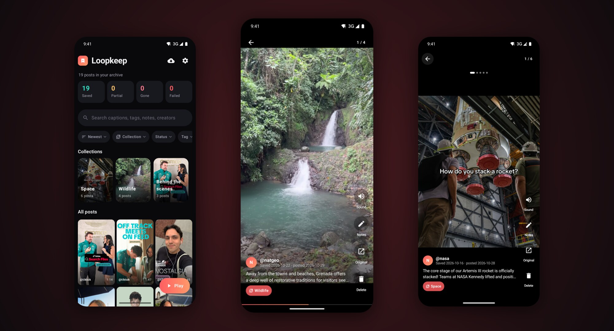
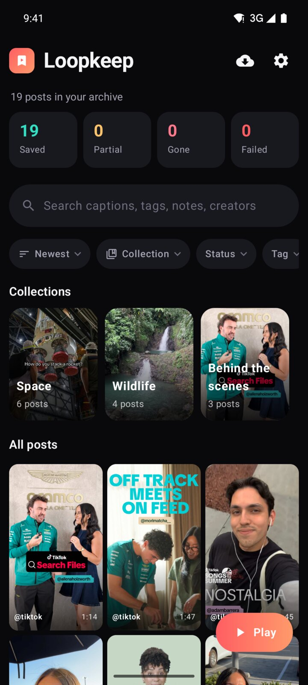
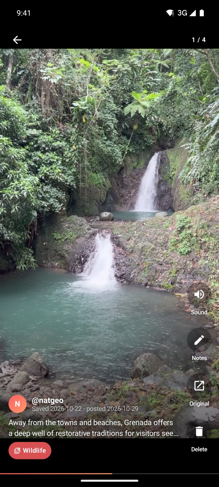
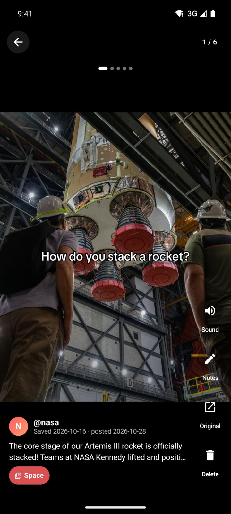
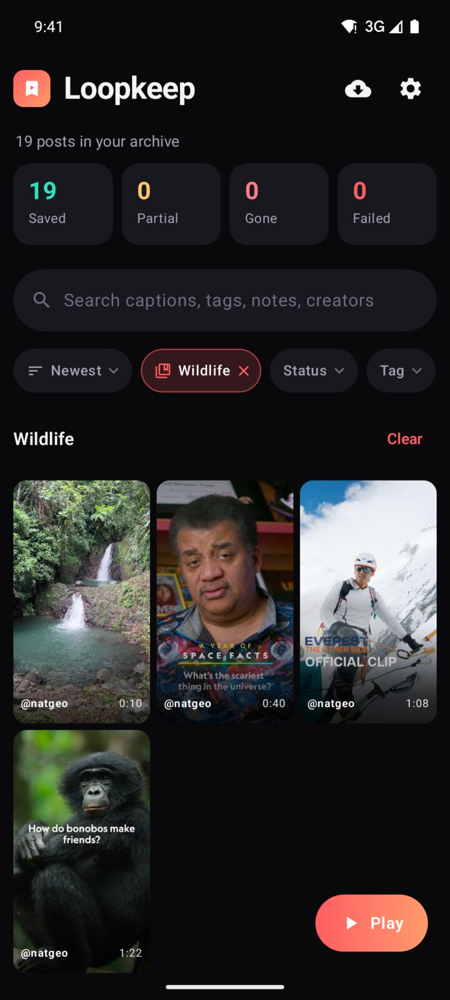
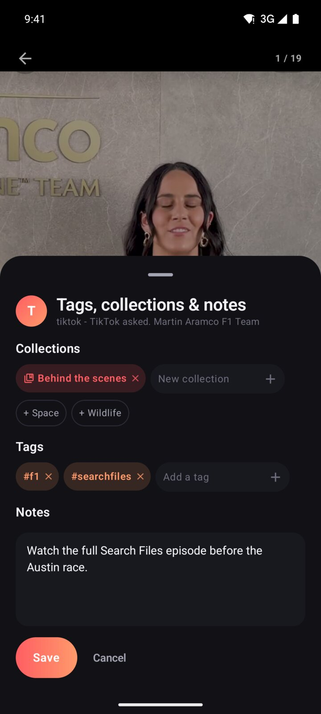
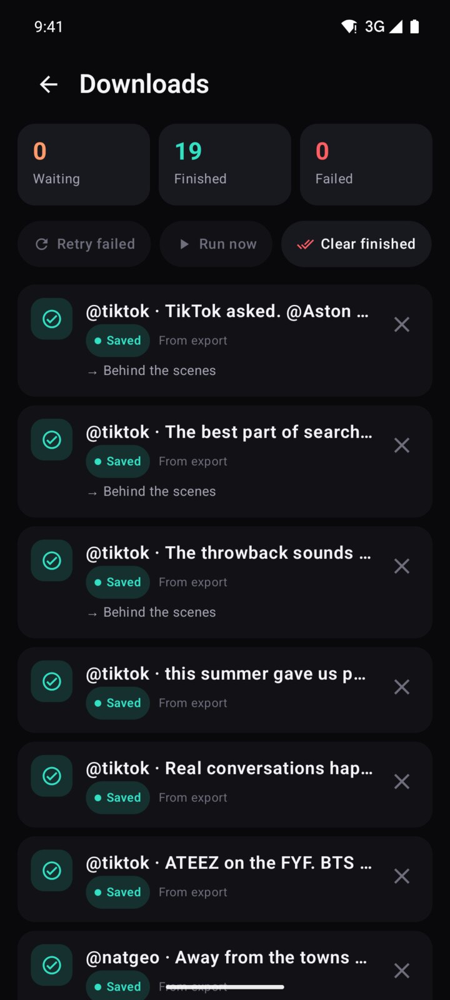
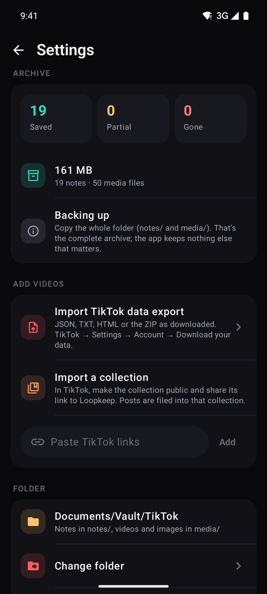
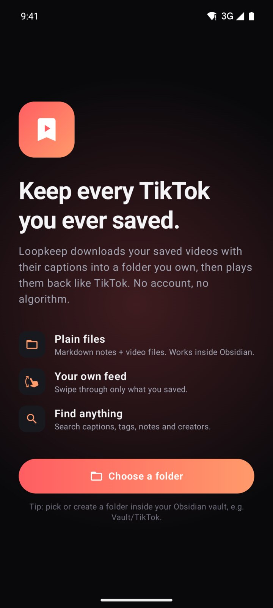

<p align="center">
  
</p>

<h1 align="center">Loopkeep</h1>

<p align="center">
  <b>Keep every TikTok you ever saved. Offline, searchable, in a folder you own.</b><br>
  Delete TikTok without losing your saves.
</p>

<p align="center">
  <a href="https://github.com/Audxius/Loopkeep/releases/latest"></a>
  <a href="https://github.com/Audxius/Loopkeep/actions/workflows/ci.yml"></a>
  
</p>



Loopkeep downloads the videos you saved on TikTok to your phone, together with their full captions, creators and dates. It puts them into a plain folder of **Markdown notes and media files** that doubles as an [Obsidian](https://obsidian.md) vault. The app is a nicer way to look at that folder:

- **Your own feed.** Full-screen vertical swiping, loop, tap to pause, seek, mute, photo carousels with sound. No account, no algorithm, no tracking, no infinite scroll: only what you saved, newest, oldest or shuffled.
- **Everything findable.** Full-text search over captions, tags, notes and creators, plus filters by collection, status, tag and creator.
- **Organised your way.** Collections, tags suggested from hashtags, and your own notes, all written back into the Markdown.
- **Honest about gaps.** Counters for saved, partial, unavailable and failed posts. If a video can't be downloaded, its caption and cover are still kept and you can retry later.

**The files are the product, the app is a viewer.** If Loopkeep disappears, the folder is still a complete, readable archive.

## Screenshots

| Library | Feed | Photo carousel | Collection |
|:---:|:---:|:---:|:---:|
|  |  |  |  |
| **Tags, collections & notes** | **Downloads** | **Settings** | **First run** |
|  |  |  |  |

## Install

**With [Obtainium](https://obtainium.imranr.dev)** (recommended, gives you updates): *Add App* → `https://github.com/Audxius/Loopkeep` → Install.

Or download `loopkeep.apk` from the [latest release](https://github.com/Audxius/Loopkeep/releases/latest) and open it on your phone.

Requires Android 8.0 or newer on a 64-bit phone.

## Using it

1. **Pick a folder.** To see your saves in Obsidian too, pick (or create) one inside your vault, e.g. `Vault/TikTok`.
2. **Bring your saves over**, any of these ways:
   - **Import your TikTok data export.** In TikTok: *Profile → ☰ → Settings → Account → Download your data → JSON*. Once it's ready, download it, then in Loopkeep tap *Import TikTok export* and pick the file (the ZIP as downloaded works too). Favourites are imported; liked videos are optional.
   - **Share** any video or photo post to *Save to Loopkeep* from TikTok's share menu.
   - **Share a collection.** In TikTok, make the collection public and share its link to Loopkeep. Its posts are saved and filed into that collection. (TikTok often refuses to list collections to apps; if so, Loopkeep tells you, and you can add the videos one by one and file them in the edit sheet.)
   - **Paste** links in Settings.
3. **Watch.** Tap a thumbnail or *Play*. Swipe up/down, tap to pause, drag the thin bar to seek, tap the caption to read all of it. The feed follows your current search, filters and collection.
4. **Organise.** *Notes* in the feed opens tags, collections and notes. Long-press a thumbnail or use *Delete* in the feed to remove a post and its files.

Downloads run in the background, one at a time and a few seconds apart, and resume after interruptions. The cloud icon shows the queue, with *Retry failed*. If downloads suddenly start failing, TikTok has probably changed something: *Settings → Update yt-dlp now*, then *Retry failed*.

## The folder

```
<your folder>/
  notes/   one .md file per post
  media/   <id>.mp4, <id>.jpg (TikTok's own cover), <id>_1.jpg … for photo posts
```

A note:

```markdown
---
tiktok_id: "7300000000000000001"
source_url: https://www.tiktok.com/@chef/video/7300000000000000001
author: Chef Anna
author_handle: chef
posted: 2025-03-01
saved: 2025-03-14
tags: [recipe, pasta]
collections: [Weeknight dinners]
status: full
duration: 34
video: "[[7300000000000000001.mp4]]"
cover: "[[7300000000000000001.jpg]]"
---

![[7300000000000000001.mp4]]

Best pasta ever 🍝 #recipe #pasta

## Notes
Made this on Sunday, add more garlic.
```

- `status` is `full` (saved), `text-only` (caption and cover only, shown as *Partial*; retry later), or `unavailable` (TikTok says the post is gone or private).
- Photo posts get `type: slideshow`, their images, and the sound.
- Edit freely in Obsidian. Loopkeep only changes its own frontmatter keys and the `## Notes` section; your caption edits, extra properties and extra sections are left alone. Changes you make in Obsidian show up the next time you open the app.

## Backup

**Copy the folder.** That's the whole archive. The app's database is only an index and is rebuilt from the files (*Settings → Rescan folder*). To move to a new phone: copy the folder, install Loopkeep, pick the folder.

## Building

```
./gradlew testDebugUnitTest assembleDebug     # JDK 17 + Android SDK
```

Signed releases are built by GitHub Actions from version tags. See [SETUP.md](SETUP.md) for signing and releasing, [TESTING.md](TESTING.md) for what's verified, and [NOTES.md](NOTES.md) for architecture and design decisions.

---

Loopkeep is an independent project and is not affiliated with TikTok or ByteDance. It's for keeping a personal copy of posts you saved. Respect creators' rights and don't re-upload their videos.
